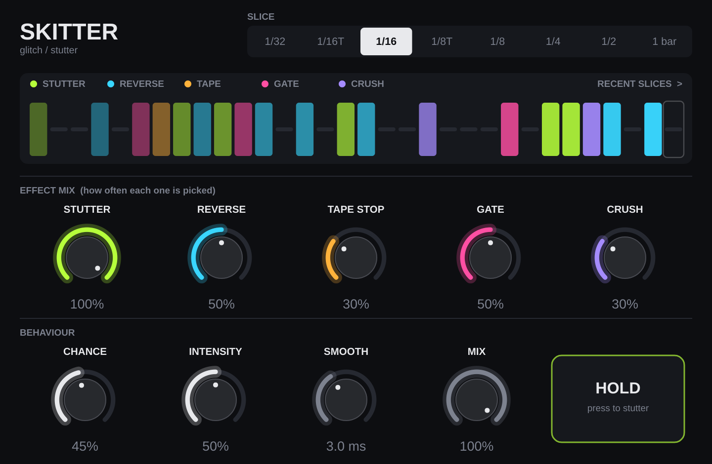

# Skitter — glitch / stutter

A tempo-synced glitch effect. It chops your audio into slices locked to the
host tempo, and on each slice rolls the dice: leave it alone, or mangle it with
one of five effects.

| Effect    | What it does |
|-----------|--------------|
| Stutter   | Loops a tiny chunk of the most recent audio. Sometimes it "rolls", with the repeats getting faster across the slice. |
| Reverse   | Plays the previous slice backwards. |
| Tape Stop | Playback slows to a halt like a turntable losing power. |
| Gate      | Chops the slice with a random on/off rhythm. |
| Crush     | Bit-depth and sample-rate reduction. |

## Controls

- **Slice**: the grid size, 1/32 up to a full bar (triplets included).
- **Effect mix knobs**: how often each effect gets picked. Turn one to zero to remove it.
- **Chance**: how many slices glitch at all. 0% = clean, 100% = every slice.
- **Intensity**: how extreme each effect is (smaller stutter loops, harsher crush, faster gates).
- **Smooth**: crossfade length at slice edges. Lower = clickier and more aggressive.
- **Mix**: dry/wet.
- **HOLD**: press and hold for a stutter on every slice. It is a parameter, so you can automate it for planned fills and drops.

It follows your DAW's tempo and bar position while the transport is playing,
so glitches land on the grid. When stopped it keeps time on its own at the host tempo.

## Building it

### Easiest: let GitHub build it (no software to install)
1. Make a free GitHub account and a new repository.
2. Upload everything in this folder (including the hidden `.github` folder).
3. Open the **Actions** tab. The "Build Skitter" run takes about 10 minutes.
4. Download **Skitter-Windows** or **Skitter-macOS** from the finished run.

### Building on your own computer
You need [CMake](https://cmake.org/download/) and Git, plus:
- **Windows**: Visual Studio 2022 Community (choose "Desktop development with C++").
- **Mac**: Xcode from the App Store.

Then, in a terminal inside this folder:

```
git clone --depth 1 --branch 8.0.4 https://github.com/juce-framework/JUCE.git JUCE
cmake -B build
cmake --build build --config Release
```

The plug-ins end up in `build/Skitter_artefacts/Release/`.

## Installing

- **Windows**: copy `Skitter.vst3` to `C:\Program Files\Common Files\VST3\`
- **Mac**: copy `Skitter.vst3` to `~/Library/Audio/Plug-Ins/VST3/` and
  `Skitter.component` to `~/Library/Audio/Plug-Ins/Components/`.
  Because the build isn't signed, macOS may block it. Run this once in Terminal:
  `xattr -cr ~/Library/Audio/Plug-Ins/VST3/Skitter.vst3 ~/Library/Audio/Plug-Ins/Components/Skitter.component`

Then rescan plug-ins in your DAW. It shows up under **Quick Hearts → Skitter**.

## Project layout

- `Source/GlitchEngine.h`: all the audio processing, plain C++.
- `Source/PluginProcessor.*`: parameters, tempo sync and DAW connection.
- `Source/PluginEditor.*`: the interface.
- `Tests/`: an offline render test and a test host that loads the built VST3.



Built with JUCE 8. JUCE is free for personal use and for small companies under
its revenue limit. Selling the plug-in commercially means checking JUCE's
license terms.
